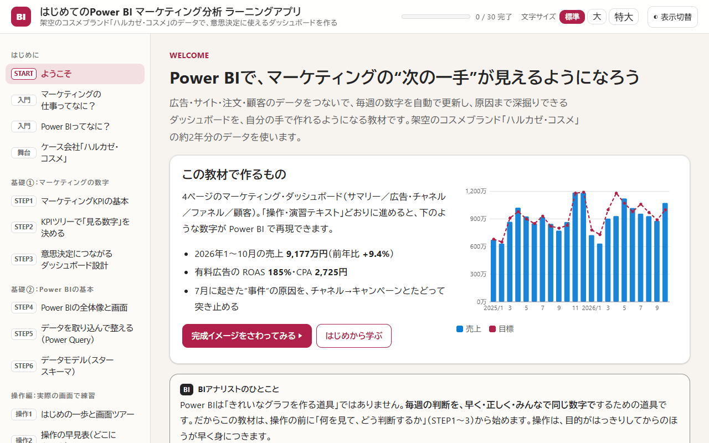
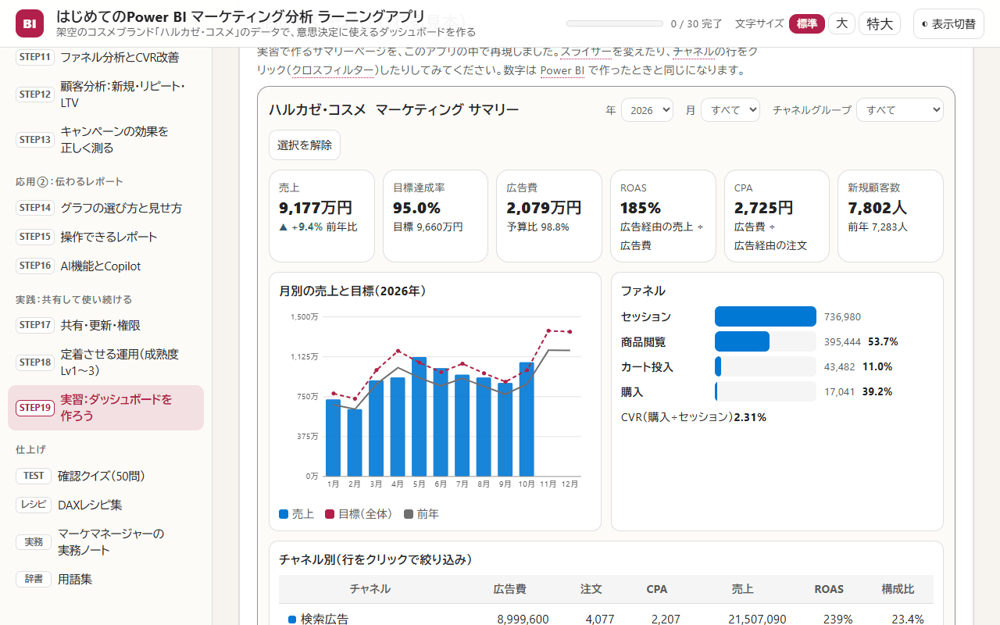

# はじめての Power BI マーケティング分析 ラーニングツール

Power BI もマーケティングもはじめての人が、マーケティングの数字の読み方から、Power BI Desktop でダッシュボードを作ってチームで使い続けるまでを、手を動かしながら学ぶ教材です。架空のコスメブランド「ハルカゼ・コスメ」の約2年分のデータを使い、4ページのマーケティング・ダッシュボード（サマリー／広告・チャネル／ファネル／顧客）を最初から作ります。

> **English summary:** A beginner-friendly Japanese course on marketing analytics with Microsoft Power BI. It includes an interactive single-file HTML app (25 lessons, 50-question quiz, 49 DAX measure recipes), an Excel workbook with self-checking exercises, a 90-page Word hands-on guide with real Power BI Desktop screenshots (36 short drills and a full dashboard build), about two years of practice CSV data for a fictional D2C cosmetics brand, and a finished sample report in Power BI Project (PBIP) format. All companies, people and figures are fictional.

<p align="center">
  
</p>

| 学習時間の目安 | 学習アプリ | 操作・演習テキスト | Excel ワークブック | 練習データ |
|:---:|:---:|:---:|:---:|:---:|
| レッスン 約11時間<br>＋実習 約7〜8時間 | 全30ページ<br>（レッスン25・クイズ50問） | 90ページ<br>（基本ドリル36本＋総合演習） | 29シート | CSV 9表<br>（2025年1月〜2026年10月） |

## 目次

- [この教材の特長](#この教材の特長)
- [すぐに始める](#すぐに始める)
- [収録ファイル](#収録ファイル)
- [ケース会社と練習データ（架空）](#ケース会社と練習データ架空)
- [カリキュラム（学習アプリ）](#カリキュラム学習アプリ)
- [Power BI の練習（操作・演習テキスト）](#power-bi-の練習操作演習テキスト)
- [試しながら学べること](#試しながら学べること)
- [学び方](#学び方)
- [動作環境と動作確認](#動作環境と動作確認)
- [よくある質問](#よくある質問)
- [注意事項](#注意事項)
- [利用について](#利用について)
- [このシリーズのほかの教材](#このシリーズのほかの教材)

## この教材の特長

- **はじめての人向け**：「マーケティングの仕事ってなに？」から始まります。むずかしい言葉は、点線にマウスを乗せると意味が出ます。各レッスンの最後に「3行まとめ」があります。
- **自分に合う順番で**：「マーケティングも Power BI もはじめて」「Power BI だけはじめて」「マーケティングだけはじめて」から選ぶと、おすすめの順番が出ます。
- **実際の画面で練習**：Power BI Desktop の実際の画面写真つきの操作テキストで、操作ごとの短い練習（基本ドリル36本）と、ダッシュボードを通しで作る総合演習を進めます。
- **答え合わせができる**：ドリルと演習で出た数字を学習アプリや Excel に入れると、正解かどうかがすぐわかります。
- **数字は確かめ済み**：答えの数字と DAX の式は、配布している練習データを Power BI Desktop に読み込んで計算し、一致することを確かめています。

## すぐに始める

1. このページの上にある緑色の **［Code］** ボタン → **［Download ZIP］** で、ファイル一式をダウンロードし、展開します（Windows は右クリック → **［すべて展開］**）。
2. Windows の PC に **Power BI Desktop**（無料）を入れます。Microsoft Store から入手できます。
3. **`PowerBIマーケティング_ラーニングアプリ.html`** をダブルクリックしてブラウザで開き、「ようこそ」で自分に合うコースを選びます。
4. **`Power BI 操作・演習テキスト.docx`** の「はじめての方へ」「準備」「はじめの一歩」を読み、`完成見本/HarukazeSample.pbip` を Power BI Desktop で開いて、完成したダッシュボードをさわってみます（上に出る帯の **［今すぐ更新］** を押すとデータが表示されます）。
5. 「練習データ」フォルダを、わかりやすい場所（例：`ドキュメント\PowerBI練習`）にコピーして、操作テキストの基本ドリルから始めます。

> [!NOTE]
> GitHub の画面で `.html` ファイルをクリックすると、アプリではなく中身のコードが表示されます。アプリとして使うときは、ダウンロードしてから開いてください。また、`完成見本` フォルダは、中のファイルの並びを変えずにフォルダごと使ってください。

## 収録ファイル

| ファイル | 内容 |
|---|---|
| [PowerBIマーケティング_ラーニングアプリ.html](PowerBIマーケティング_ラーニングアプリ.html) | 学習アプリ。全30ページ（レッスン25、確認クイズ50問、DAXレシピ集、マーケマネージャーの実務ノート、用語集103語）。基本ドリル36本の演習ナビ（答えの判定つき）と、DAXレシピ集（メジャー49本・計算列3本）を含みます |
| [PowerBIマーケティング_ラーニングワークブック.xlsx](PowerBIマーケティング_ラーニングワークブック.xlsx) | Excel 版（29シート）。KPI の計算機、○×の判定つきの問題（確認テスト50問、ドリルと総合演習の答え合わせなど、判定は200か所以上）、自分の会社の KPI ツリーや指標定義書の書き出し |
| [Power BI 操作・演習テキスト.docx](Power%20BI%20操作・演習テキスト.docx) | 実際の画面写真つきの操作テキスト（90ページ）。はじめての方へ／準備／はじめの一歩（完成見本をさわる）／画面と基本操作／基本ドリル36本／総合演習（Part 1〜8）／うまくいかないとき／答え合わせ一覧 |
| [練習データ/](練習データ/) | 演習で読み込む9つの CSV（UTF-8）と、ドリル用のファイル（`演習用/`：人が手で作った Excel の表、月ごとの CSV） |
| [完成見本/](完成見本/) | 完成したダッシュボード（Power BI プロジェクト形式 `.pbip`、4ページ・メジャー50本）。データを中に含んでいるので、練習データの場所に関係なく開けます |

<details>
<summary>フォルダの構成</summary>

```text
Power-BI-and-Marketing/
├── PowerBIマーケティング_ラーニングアプリ.html
├── PowerBIマーケティング_ラーニングワークブック.xlsx
├── Power BI 操作・演習テキスト.docx
├── 練習データ/
│   ├── Dim_Campaign.csv, Dim_Channel.csv, Dim_Customer.csv, Dim_Date.csv, Dim_Product.csv
│   ├── Fact_Ads.csv, Fact_Orders.csv, Fact_Target.csv, Fact_Web.csv
│   └── 演習用/
│       ├── 広告費レポート_手作業.xlsx
│       ├── 広告_月別CSV/        （ads_2026-07.csv 〜 ads_2026-09.csv）
│       └── 追加用/              （ads_2026-10.csv）
└── 完成見本/
    ├── HarukazeSample.pbip
    ├── HarukazeSample.Report/
    └── HarukazeSample.SemanticModel/
```

</details>

## ケース会社と練習データ（架空）

株式会社ハルカゼ・コスメ。自社の EC サイトでスキンケア化粧品（12品目）を売る D2C ブランドで、2025年の売上は約1億760万円です。あなたは4月に着任したマーケティングマネージャー。Excel は得意でも、Power BI ははじめてです。春日CMOから出された6つの宿題（「7月に目標を下回ったのはなぜ？」「来期の広告予算は、どのチャネルに配分すべき？」など）に、データで答えていきます。

練習データは、注文・サイトのアクセス・広告の実績・目標の4つの表（ファクト）と、日付・チャネル・キャンペーン・商品・顧客の5つの表（ディメンション）です。SNS 広告の CPA の急上昇や、スマホの購入完了率の低さなど、切り口を変えると見つかる“事件”が仕込んであります。

| 表 | 種類 | 行数 | 中身 |
|---|---|---:|---|
| Fact_Orders | ファクト | 50,538 | 注文明細（1行＝1つの注文の中の1商品） |
| Fact_Web | ファクト | 10,276 | サイトのアクセス（日付×チャネル×デバイスごとのセッション・商品閲覧・カート投入・購入） |
| Fact_Ads | ファクト | 3,553 | 広告の実績（表示回数・クリック数・広告費） |
| Fact_Target | ファクト | 24 | 月ごとの目標（売上・広告費予算・新規顧客） |
| Dim_Date | ディメンション | 730 | 日付（2025年・2026年） |
| Dim_Channel | ディメンション | 9 | チャネル |
| Dim_Campaign | ディメンション | 12 | キャンペーン |
| Dim_Product | ディメンション | 12 | 商品 |
| Dim_Customer | ディメンション | 23,650 | 顧客（初回購入日・獲得チャネル・年代・地域） |

## カリキュラム（学習アプリ）

| 区分 | レッスン |
|---|---|
| はじめに | マーケティングの仕事ってなに？、Power BI ってなに？、ケース会社「ハルカゼ・コスメ」 |
| 基礎① マーケティングの数字 | STEP1 マーケティング KPI の基本、STEP2 KPI ツリーで「見る数字」を決める、STEP3 意思決定につながるダッシュボード設計 |
| 基礎② Power BI の基本 | STEP4 Power BI の全体像と画面、STEP5 データを取り込んで整える（Power Query）、STEP6 データモデル（スター スキーマ） |
| 操作編 実際の画面で練習 | はじめの一歩と画面ツアー、操作の早見表（どこにある？）、演習ナビ：基本ドリル36本 |
| 基礎③ DAX で指標を作る | STEP7 はじめての DAX：メジャー、STEP8 CALCULATE とフィルター コンテキスト、STEP9 時系列：前年比・累計・移動平均 |
| 応用① マーケティング分析の型 | STEP10 広告・チャネル分析、STEP11 ファネル分析と CVR 改善、STEP12 顧客分析：新規・リピート・LTV、STEP13 キャンペーンの効果を正しく測る |
| 応用② 伝わるレポート | STEP14 グラフの選び方と見せ方、STEP15 操作できるレポート、STEP16 AI 機能と Copilot |
| 実践 共有して使い続ける | STEP17 共有・更新・権限、STEP18 定着させる運用（成熟度 Lv1〜3）、STEP19 実習：ダッシュボードを作ろう |
| 仕上げ | 確認クイズ（50問）、DAX レシピ集、マーケマネージャーの実務ノート、用語集 |

## Power BI の練習（操作・演習テキスト）

基本ドリルは1本3〜15分で、「ねらい → 操作 → 画面 → 答え合わせ → つまずきポイント」の順に進みます。

| 区分 | 基本ドリル |
|---|---|
| A データを取り込む | D01〜D03　CSV と Excel の読み込み |
| B Power Query で整える | D04〜D11　行の削除・ヘッダー・ピボット解除・置換とデータ型・フォルダーからの読み込みと更新 |
| C モデルを作る | D12〜D15　リレーションシップ・日付テーブル・列で並べ替え |
| D DAX で計算する | D16〜D22　メジャー・DIVIDE・CALCULATE・計算列・前年比・DAX クエリ ビューでの検算 |
| E ビジュアルを作る | D23〜D27　カード・組み合わせグラフ・マトリックス・条件付き書式・散布図 |
| F 操作できるレポートにする | D28〜D32　相互作用・スライサーの同期・ドリルスルー・ツールヒント・ブックマーク |
| G パラメーター・セキュリティ・共有 | D33〜D36　What-if パラメーター・フィールド パラメーター・行レベル セキュリティ（RLS）・発行 |

総合演習（3〜4時間）では、データの取り込み → モデル → メジャー → 4つのページ → 仕上げと共有、の順に、完成見本と同じダッシュボードを作ります。各 Part の終わりに答え合わせの数字があります。

## 試しながら学べること

- 広告費・CPC・CTR・CVR・客単価を動かすと、注文数・CPA・ROAS が変わる「広告の KPI 計算機」
- お客さまの行動が、どの表（データ）に記録されるかをたどる「お客さまの旅」
- どのレバーを動かすと売上がいくら増えるかを試す「KPI ツリー」
- Power Query の整形（行の削除・ヘッダー・ピボット解除）を、ボタンで1ステップずつ体験
- スター スキーマのつながりを、表をクリックして確かめる
- 7月の“事件”（SNS 広告の CPA 急上昇）を、チャネル → キャンペーン → 週とたどって原因を突き止める
- 予算配分のシミュレーター、ファネルの改善インパクト、LTV と CAC の比較
- 完成したダッシュボードの見本を、スライサーで切り替えながらさわる

<details>
<summary>画面の例：アプリの中でさわれるダッシュボードの見本</summary>
<br>
<p align="center">
  
</p>
</details>

## 学び方

1. **学習アプリ**を開き、「ようこそ」で自分に合うコースを選びます。はじめての方は「マーケティングの仕事ってなに？」から進めます。
2. **操作テキスト**の「はじめての方へ」「準備」「はじめの一歩」を読み、完成見本をさわってみます（`HarukazeSample.pbip` を開き、上の帯の［今すぐ更新］を押す）。
3. 操作テキストの第2章（基本ドリル）→ 第3章（総合演習）の順に、Power BI Desktop で手を動かします。
4. 出た数字は、学習アプリの「演習ナビ」か、Excel の「演習記録（ドリル）」「STEP19 実習」シートに入れて答え合わせをします。
5. Excel の各シートで、計算・確認問題・自分の会社への当てはめ（KPI ツリー・指標定義書・成熟度の自己診断など）を書き出します。答えは、シートの上の黄色いセルで「表示する」を選ぶと見られます。

> [!TIP]
> 1日30分〜1時間ずつでも進められます。学習アプリは、文字の大きさ（標準・大・特大）と、明るい表示・暗い表示を、画面右上で切り替えられます。

## 動作環境と動作確認

| 使うもの | 必要なもの | 補足 |
|---|---|---|
| 学習アプリ（`.html`） | Microsoft Edge、Google Chrome などのブラウザ | 1つのファイルで動きます。通信を禁止する設定（Content Security Policy）を入れてあり、外部とは通信しません。進み具合と入力した答えは、使っているブラウザの中にだけ保存されます |
| Excel ワークブック（`.xlsx`） | Microsoft Excel（Microsoft 365 版をおすすめします） | マクロは使っていません |
| 操作テキスト（`.docx`） | Word など .docx を開けるソフト | |
| 練習データ・完成見本 | Power BI Desktop（無料・Windows 用） | Power BI Desktop だけなら、ライセンスなしで練習できます |

- 2026年11月に、Power BI Desktop 2026年10月版（日本語）で、すべての手順と答えの数字を確かめています。画面の名前や配置は、バージョンアップで少し変わることがあります。
- 学習アプリは、全ページの表示・確認問題・答えの判定を、Microsoft Edge（Chromium 系のブラウザ）で確かめています。
- Excel は、全問の○×の判定・答えの表示の切り替え・シート間のリンクを、Microsoft 365 版の Excel で確かめています。

## よくある質問

<details>
<summary>GitHub で HTML ファイルを開くと、文字（コード）ばかり表示されます</summary>
<br>
GitHub は HTML ファイルをアプリとして動かさず、中身のコードを表示します。<a href="#すぐに始める">すぐに始める</a>の手順でダウンロードしてから、ブラウザで開いてください。
</details>

<details>
<summary>完成見本を開いても、グラフが空のままです</summary>
<br>
Power BI プロジェクト形式（.pbip）の見本は、開いた直後はデータが入っていません。画面の上に出る帯の［今すぐ更新］を押すと、見本の中に含まれているデータが読み込まれます。
</details>

<details>
<summary>Excel で答えを入力できません</summary>
<br>
インターネットから入手したファイルは「保護ビュー」（読み取り専用）で開きます。画面の上の帯にある［編集を有効にする］を押すと、入力できるようになります。
</details>

<details>
<summary>Mac でも使えますか？</summary>
<br>
Power BI Desktop は Windows 用のアプリのため、Power BI の実習には Windows の PC が必要です（この教材の動作確認も、Windows で行っています）。
</details>

## 注意事項

- 会社・人物・数字は、すべて学習用の架空のものです。
- 学習のための教材です。実際の広告運用や予算の判断は、自社のデータと状況にあわせて行ってください。
- Power BI サービスへの発行・共有・自動更新には、組織のアカウントとライセンスが必要です。Copilot など一部の機能は、ライセンスや組織の設定によって使えないことがあります。
- 会社で使うときは、社内のルール（使ってよいデータ・発行してよい場所・秘密度ラベル・共有の範囲）に従ってください。

## 利用について

- 個人の学習や、勉強会・研修の教材として、自由に使ってください。自分用に内容を直して使ってもかまいません。
- ファイルを販売したり、有料の講座でそのまま配ったりする場合は、先に [Issues](https://github.com/rebelnaoto7/Power-BI-and-Marketing/issues) でご相談ください。
- 正確さには注意して作っていますが、誤りがあるかもしれません。見つけたときは [Issues](https://github.com/rebelnaoto7/Power-BI-and-Marketing/issues) で教えてください。

Microsoft、Windows、Microsoft 365、Microsoft Edge、Excel、Word、Power BI、Copilot は、Microsoft グループの商標です。この教材は、Microsoft が提供・承認したものではありません。そのほかの会社名・サービス名・製品名は、それぞれの会社の商標または登録商標です。

## このシリーズのほかの教材

| 教材 | ひとことで |
|---|---|
| [はじめての連結決算](https://github.com/rebelnaoto7/Consolidated-financial-statements-learning-tool) | 架空の10か国グループで、連結決算のしくみを学ぶ |
| [外資系コントローラー養成ツール](https://github.com/rebelnaoto7/Financial-Controller-Leaning-Tool) | 外資系企業の日本法人で、月次決算・本社報告・税務・資金繰りから Power BI まで |
| [M&Aアドバイザー養成ツール](https://github.com/rebelnaoto7/MA-advisor-learning-tool) | 売り手のFAとして、企業価値の評価・交渉・DD・契約・PMI を学ぶ |
| [日本株・米国株 分析ラーニングツール](https://github.com/rebelnaoto7/stock-analysis-learning-tool) | ファンダメンタル分析とテクニカル分析を、初級から超上級まで |
| [スモールビジネス起業・経営ツール](https://github.com/rebelnaoto7/small-business-starts-and-management-tool) | 小さなお店の開業から経営まで。自分の事業に使える計画用の Excel つき |
| [はじめてのセキュリティ入門](https://github.com/rebelnaoto7/cybersecurity-learningtool) | サイバー攻撃の手口と守り方を、試しながら学ぶ |
